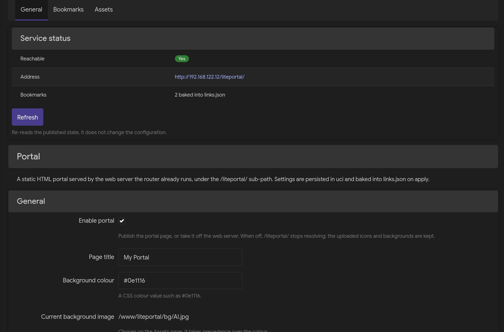

# luci-app-liteportal

给 OpenWrt / ImmortalWrt 用的**静态 HTML 导航页**：由路由器已有的 `uhttpd` 在
`/liteportal/` 子路径下提供，全部通过 LuCI 配置，自身不起任何独立进程。

[English](README.md)

| LuCI —— *服务 → Portal* | 门户页 |
|---|---|
|  |  |

## 它做什么

路由器照常在原端口提供 LuCI。本应用在**同一个** Web 服务器上额外挂一个刻意保持极简
的页面 —— 一个指向路由器（或任意位置）上各服务的书签网格，路径固定为 `/liteportal/`，
因此不需要第二个守护进程，也不需要额外开一个防火墙端口。书签、图标与背景都存放在
`uci` 中，并烘焙成静态的 `links.json`，因此门户页面本身不需要任何后端。

```
                    ┌──────────────────────────────────────┐
   :80 / :443  ────►│  uhttpd  （路由器自带的 Web 服务）   │
                    │    /             → LuCI              │
                    │    /liteportal/  → 门户页面          │
                    └──────────────────┬───────────────────┘
                                       │ 直接从磁盘读取
                                       ▼
                    ┌──────────────────────────────────────┐
                    │  /www/liteportal/                    │
                    │    index.html   liteportal.js        │
                    │    liteportal.css                    │
                    │    links.json   ◄── 由 uci 烘焙      │
                    │    bg/  icons/  ◄── 上传落在这里     │
                    └──────────────────────────────────────┘
                                       ▲
   LuCI  ── /admin/services/liteportal ────────────────────┘   发布 / 撤下页面
```

## 功能

| | |
|---|---|
| 启用开关 | 发布或撤下门户页面；上传的图标与背景图在两种状态下都保留 |
| 不额外起进程 | 由路由器已在运行的 `uhttpd` 在 `/liteportal/` 下提供，无需启动、守护或额外放行端口 |
| 书签 | 增删与启用/禁用；图标支持 emoji、远程 URL 或素材库里的图片（用素材库图片时行内显示缩略图） |
| 素材库 | 上传（单个 ≤ 2 MiB）、预览、重命名、列出与删除图标/背景图，并可直接设为页面背景 |
| 外观 | 页面标题、CSS 背景色或背景图，另有背景压暗、磨砂模糊、书签卡片透明度三个 0–100 滑块 |
| 搜索框 | 平时隐藏，按空格键唤出的搜索框；查询由浏览器直接提交给所选引擎，完全不涉及后端 |
| Discovery | 读取 `/proc/net/tcp[6]`，把已知的 Web 服务加成**禁用**书签，其余端口交给你决定 |
| 运行状态 | 报告页面是否**可访问**；不可访问时指出是「未发布」还是「服务器未监听」，并给出访问地址与已生成的书签数 |
| 纯静态 | 配置存 `uci`，生成 `links.json` 供前端读取，页面本身不需要后端 |
| 不依赖 `luci-compat` | 现代 LuCI（JavaScript 视图 + ucode 后端），无需 Lua 运行时 |

## 搜索框怎么用

在**常规 → 搜索框**里打开它，门户页就多了一个平时不占地方、需要时才出现的搜索框。
设计意图很直接：门户页是一页链接，常驻输入框会和书签抢注意力。

| 操作 | 效果 |
|---|---|
| 在页面任意位置按 `空格` | 搜索框出现并自动聚焦 |
| 输入框为空时再按 `空格`，或按 `Esc` | 收起搜索框 |
| 输入关键字后按 `回车` | 结果页在新标签页打开，门户页的输入框清空并收起 |

两个容易踩到的细节：

- **输入框里有内容时，空格就是空格。** 只有空输入框才会被空格收起，所以搜「open wrt」
  这种多词查询不用按修饰键。
- **输入法优先。** 正在组字（拼音、假名等）时空格交给输入法；页面上其他文本输入框也
  各自保留自己的空格键。

查询由浏览器直接提交给搜索引擎，路由器这一侧不需要任何后端方法，ACL 里也没有对应条目。
引擎在同一个**常规**页选择：Google、Bing、DuckDuckGo、百度，或「自定义」并填自己的
结果页 URL（`%s` 表示关键字的位置）。

## 环境要求

| 组件 | 最低版本 |
|---|---|
| OpenWrt / ImmortalWrt | 23.05（JS LuCI + ucode） |
| 软件包 | `luci-base`、`uhttpd`、`ucode`、`rpcd-mod-ucode`（会自动拉取） |

## 安装

```sh
# OpenWrt 25.12 及更新（apk）
apk add --allow-untrusted ./luci-app-liteportal-4.0.1-r1.apk

# OpenWrt 24.10 及更早（opkg），需用对应 SDK 构建
opkg install ./luci-app-liteportal_4.0.1-r1_all.ipk
```

然后进 LuCI 的**服务 → Portal**，或直接访问 `http://<路由器>/liteportal/`。

## 目录结构

| 路径 | 用途 |
|---|---|
| `htdocs/luci-static/resources/liteportal/common.js` | 共享工具：RPC 封装、状态面板、错误上报 |
| `htdocs/luci-static/resources/view/liteportal/general.js` | LuCI 视图 —— 开关、标题、背景、外观、维护 |
| `htdocs/luci-static/resources/view/liteportal/bookmarks.js` | LuCI 视图 —— 书签表格 |
| `htdocs/luci-static/resources/view/liteportal/assets.js` | LuCI 视图 —— 图标与背景素材库 |
| `root/usr/share/luci/menu.d/luci-app-liteportal.json` | 菜单注册 |
| `root/usr/share/rpcd/acl.d/luci-app-liteportal.json` | 各视图的 ubus / uci / 文件权限 |
| `root/usr/share/rpcd/ucode/liteportal.uc` | 后端：`luci.liteportal` ubus 对象（仅插件，无 CLI 模式） |
| `root/etc/init.d/liteportal` | 服务脚本：发布 / 撤下页面并生成 `links.json`，本身不起任何进程 |
| `root/usr/share/liteportal/www/` | 门户前端模板（`index.html`、`liteportal.js`、`liteportal.css`），会被拷进 `/www/liteportal/` |
| `root/etc/config/liteportal` | 默认 `uci` 配置 |
| `scripts/check.sh` | 本地与 CI 的全部检查门禁 |
| `docs/` | 架构、完成定义、配置说明与 ADR |

## 后端 API

`/usr/share/rpcd/ucode/liteportal.uc` 由 `rpcd-mod-ucode` 加载，暴露为 `luci.liteportal`
ubus 对象：

```sh
ubus call luci.liteportal generate
# { "ok": true, "title": "My Portal", "links": 2 }

ubus call luci.liteportal scan
# { "lan_ip": "192.168.1.1",
#   "ports": [ { "port": 80, "svc": "http", "web": true },
#              { "port": 22, "svc": "ssh", "web": false },
#              { "port": 7890, "svc": "", "web": "unknown" } ] }

ubus call luci.liteportal status
# { "ok": true, "enabled": true, "path": "/liteportal/", "published": true,
#   "server_listening": true, "reachable": true, "links": 2,
#   "generated": true, "generated_at": 1791124783 }

# 素材管理 —— 浏览器只能写 /tmp/liteportal_upload.tmp，由后端搬到最终文件名
ubus call luci.liteportal upload '{ "dir": "bg", "name": "wallpaper.jpg" }'
ubus call luci.liteportal rename '{ "dir": "bg", "name": "wallpaper.jpg", "new_name": "home.jpg" }'
ubus call luci.liteportal remove  '{ "dir": "bg", "name": "home.jpg" }'
```

上面每个方法都必须出现在 `root/usr/share/rpcd/acl.d/luci-app-liteportal.json` 中，
否则浏览器里会得到 *Access denied*。`scripts/check.sh` 每次运行都会核对这份对应关系。

扫描结果的 `web` 字段有三种取值：

| 取值 | 含义 |
|---|---|
| `true` | 已知的 Web 服务 —— 会加成禁用状态的书签 |
| `false` | 确定不是浏览器目标（`ssh`、`dns`、`mdns`、`dhcp`、`ntp`、`openvpn`、`wireguard` 等）—— 不会提示 |
| `"unknown"` | `/etc/services` 里没有对应条目 —— 弹窗列出，由你决定 |

端口号本身不携带协议信息，所以 `7890` 可能是代理也可能是任意 TCP 服务，`1053` 是
mDNS。与其双向猜测，不如把未识别的端口列出来让你一次性勾选添加为禁用书签。

该脚本**仅作插件** —— rpcd 加载时不会定义 `ARGV`，因此它无法兼作命令行工具。
按上例通过 ubus 调用即可。

`status` 只回答一个问题 —— 页面能不能打开 —— 并把背后的两个条件分开报告，因为两者
的修法不同：`published`（入口文件与 `links.json` 是否就位）与 `server_listening`
（主 uhttpd 是否占着它被配置的某个端口）。`reachable` 是这两者的交集。结果里不含
`url`：地址由浏览器用自身 origin 加 `path` 拼出 —— 那才是**正在**提供页面的地址。

## uci 配置参考

```
config liteportal
	option enabled           '1'         # 总开关；'0' 把页面从 Web 服务器上撤下
	option title             'My Portal' # 页面标题与 <title>
	option background        '#0e1116'   # CSS 颜色
	option background_file   ''          # /www/liteportal 下的绝对路径
	option bg_veil           '78'        # 0-100：背景图被压暗的程度
	option bg_blur           '0'         # 0-100：磨砂模糊，100 等于最大值 20 px
	option card_transparency '45'        # 0-100：100 表示卡片完全透出背景
	option search_enabled    '0'         # '1' 打开空格键唤出的搜索框
	option search_engine     'https://www.google.com/search?q=%s'  # 结果页 URL，%s 为关键字

config link
	option name     'AdGuard Home'
	option url      'http://192.168.1.1:3000'
	option icon_url '🛡️'              # 或：option icon '/www/liteportal/icons/x.png'
	option enabled  '1'
```

页面本身不占端口：它在**主 uhttpd 监听的端口**上访问，因此没有需要放行的防火墙规则。

`enabled` 的语义是「发布或撤下页面」，而不是「启停一个守护进程」。关闭它会从
`/www/liteportal/` 移除入口文件与 `links.json`，使 `/liteportal/` 不再解析；上传的图标与
背景图原封不动，重新打开即恢复。

`links.json` 原样带上标题、背景与三个外观百分比；`liteportal.js` 把百分比转成
`liteportal.css` 消费的 CSS 自定义属性，所以门户页自己不必读 uci。缺项会在后台回落到
同一个默认值，因此只写了一部分的配置照样能渲染。

`search_enabled` 打开搜索框，缺省（没有这一项）视为关闭。`search_engine` 是引擎的结果页
URL，用 `%s` 表示关键字；在设置页选「自定义」时，页面改用 `search_url` 里的模板，该选项
只在那时才会被写入。引擎清单只存在于 LuCI 表单：`links.json` 只带解析后的模板，门户页
本身不持有任何引擎知识。**键盘交互见上文「搜索框怎么用」。**

`/etc/config/liteportal` 一有变化，`links.json` 会自动重新生成（LuCI 点「保存并应用」，
或 `uci commit` 加 `/etc/init.d/liteportal reload`）。

## 排查

「常规」页有「运行状态」面板；同样的数据也可以从命令行取：

```sh
ubus call luci.liteportal status
```

| 现象 | 原因 |
|---|---|
| `enabled: false` | 「常规」页的开关被关掉了，勾上并点「保存并应用」 |
| `published: false` | 页面不在磁盘上：服务还没跑过，或开关是关的。`sh /etc/init.d/liteportal start` 会发布它 |
| `server_listening: false` | 主 uhttpd 没有在它被配置的任何一个端口上监听 —— 检查 `/etc/config/uhttpd` |
| 面板说「可访问」但 `/liteportal/` 返回 404 | 主实例的 `option home` 不是 `/www`，它在提供另一棵树 |
| 页面能开但没有书签 | `links.json` 缺失或为空：点「保存并应用」重新烘焙，或 `ubus call luci.liteportal generate` |
| 浏览器控制台报 *Access denied* | 有 ubus 方法没写进 ACL —— 跑一下 `sh scripts/check.sh` |

页面由主 uhttpd 提供，因此继承该实例的监听地址与防火墙规则 —— 没有单独的端口需要
放行。反过来也要知道：**LuCI 能访问到的地方，`/liteportal/` 就能访问到**，包括把管理界面
暴露在 WAN 上的情形。

## 已知限制

| 限制 | 原因 |
|---|---|
| 上传单个文件 ≤ 2 MiB | 前端与后端都做校验，手工构造的请求也绕不过去。多兆的背景图**显示**没问题，限的只是上传 |
| 文件名仅限 ASCII 字母数字与 `.` `-` `_` | 文件名会变成设备路径；直接拒绝比悄悄改写用户输入更安全，也能从根上杜绝路径穿越。中文名与空格会被拒绝 |
| 页面在 LuCI 可达处皆可达 | 它与 LuCI 由同一个 uhttpd 提供，因而继承管理界面的暴露范围 —— 没有一个单独留着的端口可供收紧。要让它不可达，等于让 LuCI 不可达 |
| 位置固定在 `/liteportal/` | 页面必须落在主实例的 `option home`（默认 `/www`）之内，而 LuCI 侧的文件 ACL 是静态清单 —— `home` 被改过就需要人工调整本包 |
| 不会主动探测未识别端口 | 判定端口是否说 HTTP 需要在同步 ubus 方法里做带超时的 `GET /`，会阻塞整个 rpcd（连带所有 LuCI 页面）。因此改为列出来由你决定 |
| 设为背景只暂存 | 与其他设置一致，需点「保存并应用」才生效 —— `generate()` 跑在后端进程里，用的是它自己的 `uci` cursor，否则会烘出旧值 |

## 构建

构建需要与目标固件匹配的 Linux SDK —— WSL2 + Ubuntu 完全可用，但 SDK 与源码树必须
放在 Linux 文件系统里，**不能**放在 `/mnt/` 下。

```sh
tar --zstd -xf immortalwrt-sdk-<version>-<arch>_gcc-*.tar.zst
cd immortalwrt-sdk-*/

./scripts/feeds update -a
./scripts/feeds install -a

cp -r /path/to/luci-app-liteportal package/luci-app-liteportal
make defconfig
make package/luci-app-liteportal/compile V=s
```

产物在 `bin/packages/<arch>/luci/`。注意 SDK 自带的 `.config` 描述的是一整个固件镜像；
除非你确实要编译整个包树，否则请先删掉其中的 `CONFIG_PACKAGE_*=m` 行。

## 开发

```sh
sh scripts/check.sh
```

这就是 CI 跑的那道门禁：JS 语法、JSON 合法性、`shellcheck`、`msgfmt --check`、
ubus↔ACL 对应关系、行尾、以及模板占位符残留。任一项失败即以非零退出。单条命令见
[AGENTS.md](AGENTS.md) §2，代码约定见 [docs/architecture.md](docs/architecture.md)。

## 许可证

GPL-2.0-only，见 [LICENSE](LICENSE)。
